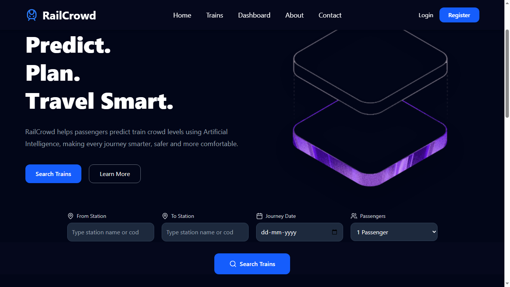
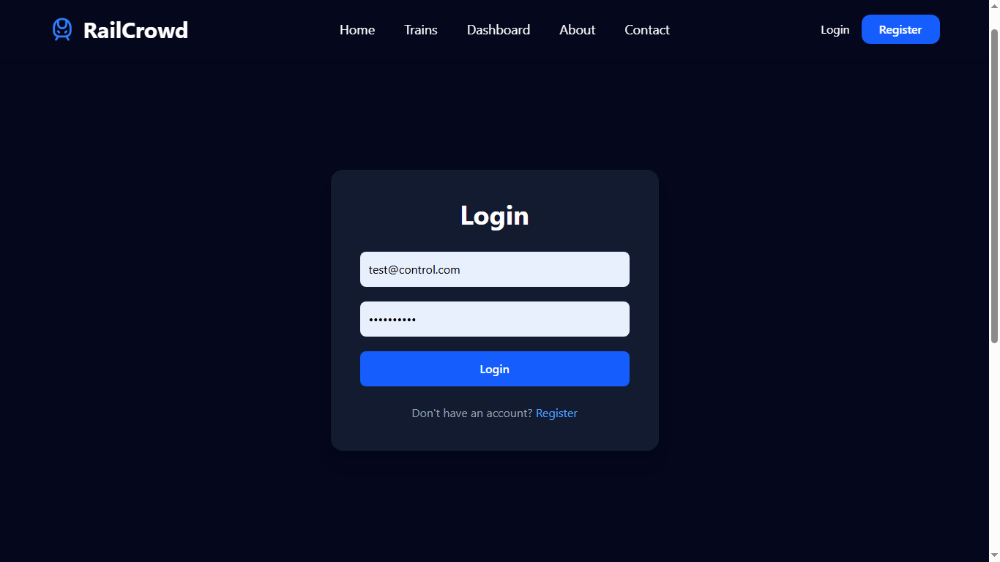
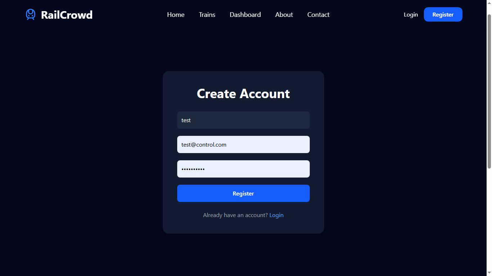
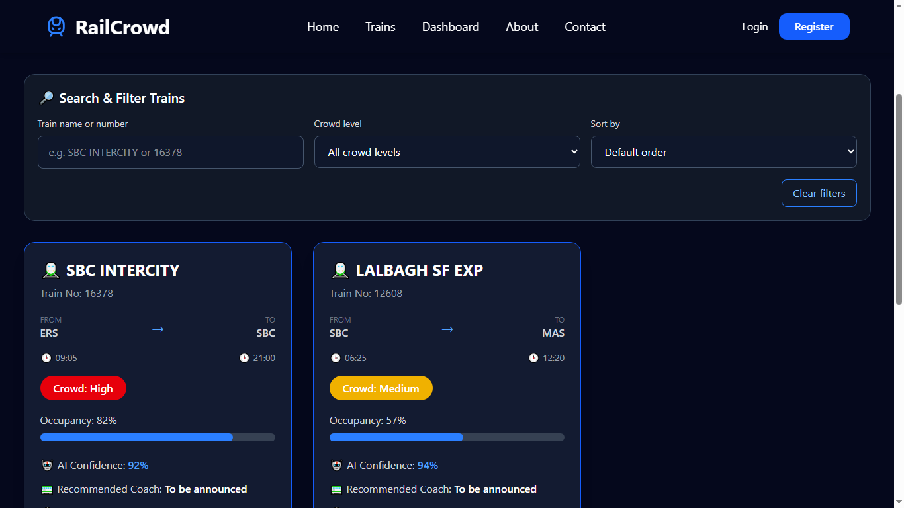
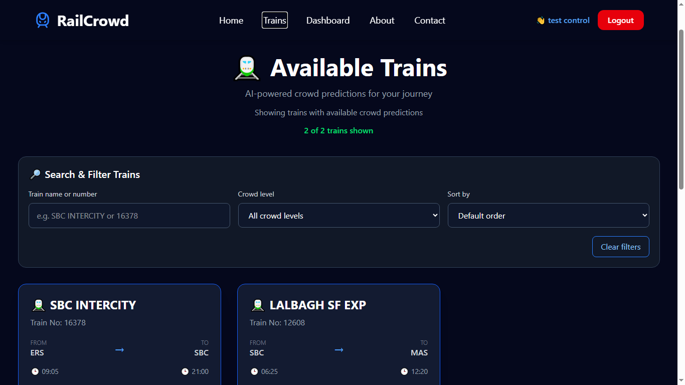
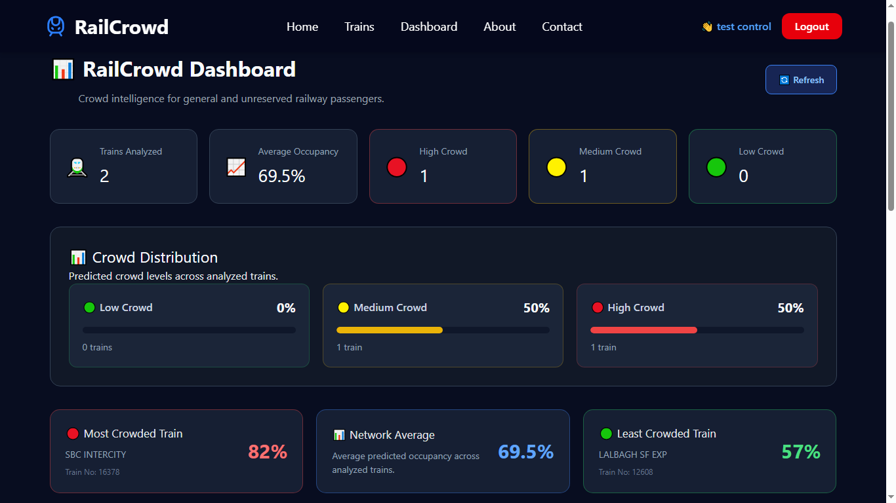
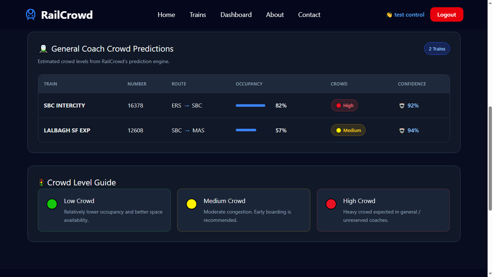
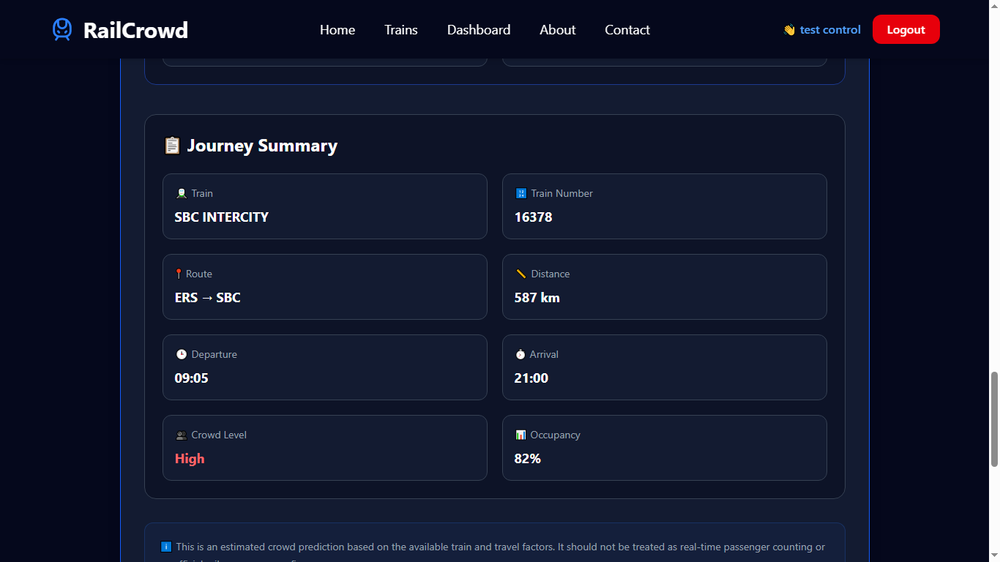
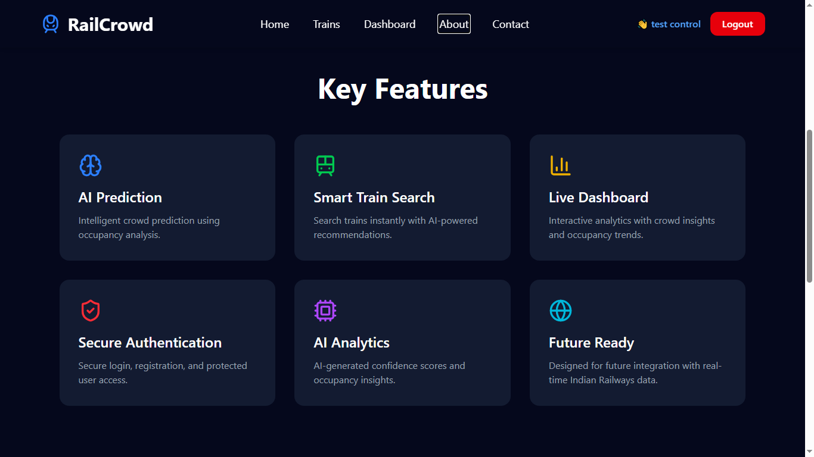
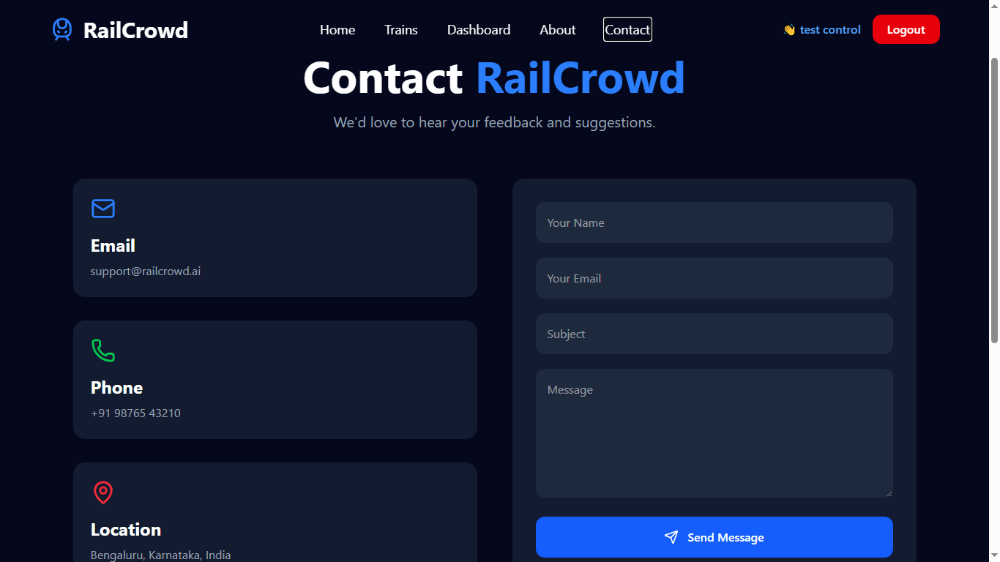

# RailCrowd – Predict. Plan. Travel Smart. 🚆

RailCrowd is a full-stack web application designed to help passengers explore train routes and understand estimated train crowd levels through AI-based predictions. It provides train search, crowd analytics, occupancy estimates, and detailed prediction insights through a modern web interface.

## 📌 Project Overview

RailCrowd combines a React frontend, Flask backend, and MySQL database to provide a convenient platform for train information and estimated crowd analysis.

Users can search for trains, view train details, explore dashboard analytics, and check predicted crowd levels before planning their journey.

**Note:** Crowd levels and occupancy percentages are estimates generated by the application's prediction logic. They are not verified real-time passenger counts.

## ✨ Features

- **Interactive Dashboard** – View train analytics and crowd statistics.
- **Smart Train Search** – Search for trains using source and destination station codes.
- **Train Details** – Explore train numbers, station routes, stops, and available timings.
- **AI-Based Crowd Prediction** – View estimated occupancy percentages and crowd levels.
- **Prediction Details** – Explore journey summaries, prediction confidence, and contributing factors.
- **User Authentication** – Login and registration pages.
- **Crowd Level Indicators** – Identify Low, Medium, and High crowd categories.
- **Search and Filters** – Filter train results by train name, train number, and crowd level.
- **Responsive Dark UI** – Navigate the application through a modern, dark-themed interface.

## 🛠️ Tech Stack

### Frontend
- React
- Vite
- JavaScript
- HTML5
- CSS3

### Backend
- Python
- Flask
- Flask-CORS
- REST API architecture

### Database
- MySQL

### Development Tools
- Visual Studio Code
- Git and GitHub
- npm
- Python virtual environment

## 📂 Project Structure

```text
RailCrowd/
├── assets/
├── backend/
│   ├── routes/
│   ├── services/
│   └── app.py
├── docs/
│   └── screenshots/
│       ├── home-page.png
│       ├── login-page.png
│       ├── register-page.png
│       ├── train-search.png
│       ├── train-search-filters.png
│       ├── dashboard-overview.png
│       ├── crowd-predictions.png
│       ├── ai-prediction-detail.png
│       ├── about-page.png
│       └── contact-page.png
├── frontend/
│   ├── public/
│   ├── src/
│   ├── package.json
│   └── vite.config.js
├── .gitignore
└── README.md
```

*Note: The structure above illustrates the main project areas. Actual backend filenames and folders may vary depending on the current implementation.*

## ⚙️ Prerequisites

Install the following before running the project:

- Python 3.10 or a compatible version
- Node.js and npm
- MySQL Server
- Git

## 🚀 Getting Started

Follow these steps to run RailCrowd locally.

### 1. Clone the Repository

```bash
git clone https://github.com/KABILAN909/RailCrowd.git
cd RailCrowd
```

### 2. Configure the Database

1. Start your MySQL server.
2. Create a database for RailCrowd.
3. Configure the database connection using the settings expected by the backend.
4. Import or create the required tables and train data.

Use the database name, table structure, and configuration expected by your existing backend code.

**Security:** Keep database passwords and other secrets out of GitHub. Use environment variables or a local configuration file excluded by `.gitignore`.

### 3. Start the Backend

Open a terminal in the project root:

```bash
cd backend
```

Create and activate a virtual environment:

```bash
python -m venv venv
```

On Windows:

```bash
venv\Scripts\activate
```

Install the backend dependencies:

```bash
pip install -r requirements.txt
```

If your backend does not contain a `requirements.txt` file yet, install the dependencies listed in your project imports and create a requirements file before following this step.

Start the Flask application using the entry point configured in your project. If `app.py` contains the Flask application instance named `app`, run:

```bash
python app.py
```

The backend is expected to run at:

`http://127.0.0.1:5000`

### 4. Start the Frontend

Open a **second terminal** from the project root:

```bash
cd frontend
npm install
npm run dev
```

Open the local URL printed by Vite, usually:

`http://localhost:5173`

Keep both backend and frontend terminals running while using the application.

## 🔌 API Endpoints

The following endpoints are used by the application.

| Method | Endpoint | Purpose |
|---|---|---|
| GET | `/api/analytics` | Retrieve dashboard analytics |
| GET | `/api/trains/search?from=SBC&to=MAS` | Search trains between stations |
| GET | `/api/trains/16378` | Retrieve train stop details |
| GET | `/api/prediction/16378` | Retrieve crowd prediction for a train |
| POST | `/api/login` | User login, subject to backend implementation |
| POST | `/api/register` | User registration, subject to backend implementation |

Replace sample train numbers and station codes with the values supported by your database. Request formats and response structures depend on the backend implementation.

## 📸 Screenshots

### 1. Home Page



The home page introduces RailCrowd and provides access to train search and other sections.

### 2. Login Page



The login page allows existing users to access the application.

### 3. Register Page



The registration page provides the interface for creating a user account.

### 4. Train Search



View train results, routes, timings, crowd levels, and estimated occupancy.

### 5. Train Search Filters



Filter train results using the available search and sorting controls.

### 6. Dashboard Analytics



Explore dashboard analytics and a summary of estimated train crowd conditions.

### 7. Crowd Predictions



Compare estimated occupancy, crowd categories, and prediction confidence across trains.

### 8. AI Prediction Details



View a detailed prediction page with a journey summary, estimated crowd level, occupancy, and available prediction insights.

### 9. About Page



Learn about RailCrowd's key features and intended purpose.

### 10. Contact Page



View the application's contact section.

## 🧪 Testing

Before using or presenting the project, verify the following:

- The Flask backend starts without errors.
- The React frontend starts successfully.
- The database connection works.
- Login and registration behave as expected.
- Train search returns the expected results.
- Train details display the correct available station information.
- Crowd prediction works for a known train.
- An unknown train returns an appropriate error response.
- Dashboard analytics load successfully.
- Screenshots display correctly in the GitHub README.

## 🔒 Security and Data Limitations

- Do not commit passwords, API keys, database credentials, or private environment files.
- Use test accounts when capturing screenshots for a public repository.
- Do not include real passwords or sensitive user information in screenshots.
- Treat crowd levels, occupancy percentages, and confidence scores as application estimates unless validated against reliable real-world data.
- Real-time passenger counts and railway operational data are not guaranteed by this application.

## 🔮 Future Improvements

- Integration with verified real-time railway data sources.
- Improved prediction accuracy using additional datasets.
- Expanded train, route, and station coverage.
- More comprehensive prediction evaluation and testing.
- Enhanced mobile responsiveness and accessibility.
- Additional analytics and historical crowd trends.
- Automated backend testing and deployment.

## 👨‍💻 Author

**Kabilan K**

GitHub: [KABILAN909](https://github.com/KABILAN909)

## 📄 License

Refer to the repository's `LICENSE` file for licensing terms.

---

**RailCrowd – Predict. Plan. Travel Smart.**  
Making train journeys easier to explore through crowd insights and intelligent predictions.
